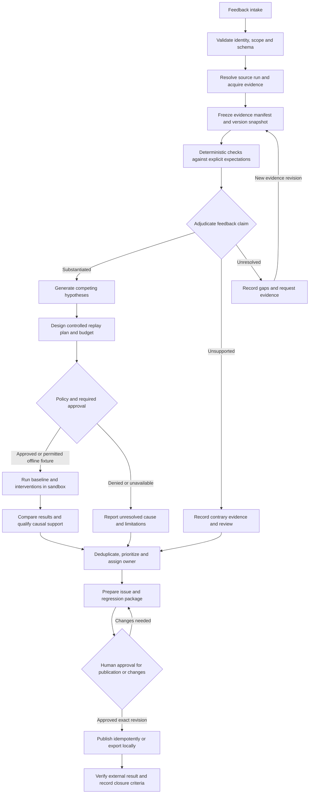
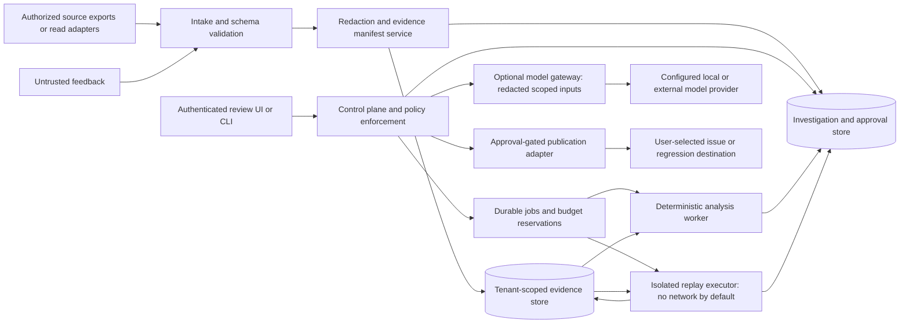

# Evaluape architecture proposal

Status: design proposal, not an implemented system. Technology choices remain provisional. This independent design intended for open-source release uses synthetic examples and public standards; it requires no Almic connection, internal implementation, proprietary schemas, or proprietary material.

## 1. Purpose and boundary

Evaluape converts feedback about a software or AI-assisted interaction into an evidence-backed investigation, a bounded explanation of what may have gone wrong, and a reviewed issue/regression package. It is not an autonomous production repair agent, an oracle of user intent, or proof that a single component caused an outcome. The system must remain useful with ordinary software traces and deterministic assertions, with no model provider configured.

The unit of work is an investigation tied to immutable evidence revisions. A report of a bad output is a claim to investigate, not automatically a bug. A real failure does not automatically establish its cause. A passing replay does not automatically establish a fix.

### Assumptions to validate

- Initial maintainers are a small team; self-hosting and an offline demonstration matter more than hyperscale ingestion.
- Users can supply lawful, authorized exports or read-only source adapters. Complete historical traces and reconstructable environments are not guaranteed.
- Reviewers can define expected behavior or identify missing specifications. Feedback can be mistaken, incomplete, contradictory, or adversarial.
- External tools may have side effects; production credentials are never necessary for the offline path.
- Investigation latency is initially asynchronous. Volume, residency, concurrency, and availability targets are deployment decisions, not invented product guarantees.

## 2. Architecture alternatives

| Alternative | Shape | Advantages | Costs and risks | Appropriate decision gate |
|---|---|---|---|---|
| A. Local/offline investigator | CLI or local UI; files plus embedded relational store; sequential or local worker execution | Small attack surface, private evidence, reproducible synthetic demos, simple install, no service dependencies | Limited collaboration, weak cross-user isolation unless OS boundaries are enforced, more manual exports and approvals | Choose for a solo-maintainer first release, strict offline deployments, or proving the investigation contract |
| B. Modular application with isolated workers | One control-plane application, relational state, evidence object store, durable job leasing, separately sandboxed replay processes | Clear transactions and approval boundaries, approachable operation, incremental scale, good shared review | Scheduler/retry responsibilities remain; sandboxing needs real operational engineering; shared-store isolation must be tested | Possible shared-team successor after the offline proof, subject to workload and threat-model validation |
| C. Distributed workflow and event platform | Dedicated intake, evidence, evaluation and publishing services; durable workflow engine/broker; independent stores or projections | Long-running resumable workflows, independent worker scale, service-level isolation, mature orchestration options | More moving parts, eventual consistency, versioned event contracts, larger security and observability burden | Adopt only when measured concurrency, workflow duration, independent team ownership, or reliability requirements exceed B |

All three are viable. These are deployment architectures, not language mandates. A and B can share the conceptual schema and fixture format; a future C should consume versioned commands/events rather than replicate application internals.

### Provisional stack, not a lock-in decision

**Recommend option A for V0:** a file-first offline investigation experiment with a portable manifest, synthetic fixtures, deterministic checks, and locally persisted review decisions. A Python CLI is a provisional implementation choice; language selection remains a gate. Plain versioned JSON plus content-addressed local artifacts may suffice initially; add SQLite only if indexing/concurrency requirements justify it. No web service, network adapter, external model, broker or hosted database is required to prove the protocol. Existing products already offer investigation, experimentation and issue workflows; this proposal makes no uniqueness claim. Its hypothesis to validate is the usefulness of portable, auditable adjudication and intervention records across systems.

For a later option B, a reasonable baseline to prototype later is Python for investigation logic, a small typed HTTP service, PostgreSQL for relational state and job leasing, and a filesystem/S3-compatible evidence-store adapter. A browser UI can be added independently; no frontend framework is selected. Use JSON documents validated against versioned schemas for portable interchange. Keep the scheduler behind a job interface; do not require Redis, Kafka, or a commercial workflow service in the first milestone.

Rationale: Python fits evaluation and analysis work; a transactional relational store makes approval versions, unique idempotency keys, and state transitions explicit. Blob storage avoids putting large traces into transaction rows. A database-backed job lease is operationally simpler for the assumed small workload. These are engineering judgments to test, not benchmarks or claims of universal superiority.

Alternatives remain open:

- TypeScript can reduce context switching for a UI-heavy maintainer team; Go can suit a small operational binary and constrained worker control plane. Both can implement identical adapter contracts.
- SQLite plus local files is the likely offline mode; PostgreSQL becomes useful for concurrent collaborative writes. A document database is possible but must demonstrate cross-entity approval and publication consistency. A vector store is optional for approximate grouping, never the source of truth.
- A durable workflow engine may replace job leasing if multi-day, externally signalled workflows make custom recovery too complex. A broker may help throughput, but delivery semantics still require idempotent consumers.
- Containers may be sufficient for trusted fixture execution; hostile replay code requires a stronger isolation boundary such as a microVM or a dedicated isolated host. A container alone is not declared a security boundary.

Selection gate: before implementation, record maintainers' language expertise, target OS/deployment, data sensitivity, benchmark workload, offline requirements, acceptable operational dependencies, and sandbox threat model. Approve an ADR with explicit reversal costs. Do not install or configure this provisional stack as part of this planning repository.

## 3. Lifecycle

Substantiation and cause analysis are separate axes. Unsupported means supplied evidence contradicts the specified claim under the recorded expectation; it does not mean the reporter is dishonest or that no other defect exists. Unresolved means missing, conflicting, or inadequate evidence. Multiple claims in one report can receive different adjudications. A substantiated case can have unresolved cause. Closure can mean reviewed triage completed, not fixed; the closure reason must distinguish those outcomes.

## 4. Components and trust boundaries

The control plane owns authorization, job creation, durable transitions, and approval validation. Workers cannot publish, grant themselves capabilities, change tenant context, or obtain production secrets. Untrusted data is never interpreted as control-plane instruction. Model output has no privileged tool channel and is validated as another proposed analysis artifact.

### Module responsibilities

1. **Intake:** validate limits and schemas, authenticate the source, assign trusted tenant context, record original feedback and declared run references. Reject or quarantine ambiguous identity joins.
2. **Evidence acquisition:** resolve original input/output, trace, tool calls/results, retrieval records, versions, and expectations through authorized read interfaces. Record what is absent and why; do not silently substitute a present-day run.
3. **Normalization and preservation:** retain original authorized artifacts in restricted storage where permitted; create separately identified redacted derivatives; preserve mapping version and exact source references.
4. **Adjudication:** execute deterministic predicates first, then human review and optional model-assisted suggestions. Attach evidence citations, expectation versions, contradictions, and gaps to every finding.
5. **Hypothesis analysis:** generate multiple explanations and disconfirming tests. Examples include ambiguous expectation, wrong input, stale corpus, retrieval omission, tool failure, orchestration defect, output transformation, model variability, and measurement error. Do not force mutually exclusive explanations.
6. **Replay:** validate a frozen plan, reserve budget, run isolated baselines/interventions, and record all attempts including timeouts, cancellations and failed setup. Preserve environment mismatches.
7. **Triage:** suggest within-tenant duplicates, explain priority and ownership, preserve dissenting reports and merge/split history. Similar symptoms are not evidence of identical causes.
8. **Delivery:** assemble a reviewable issue and regression bundle, bind approval to its digest and target, publish at most once logically, then verify the external result.

## 5. Adapter contracts (design only)

No executable interfaces or adapters are included. The following contracts should become versioned conformance specifications before implementation.

| Interface | Inputs | Outputs and guarantees |
|---|---|---|
| FeedbackSource | Authorized tenant scope, cursor, bounded time range | Reports with source IDs/times, cursor, provenance; stable pagination and replayable ingestion key |
| RunResolver | Scoped external run/trace references | Zero, one, or multiple candidates plus match evidence; ambiguity is explicit, never guessed |
| EvidenceReader | Scoped run reference, requested artifact types, acquisition budget | Artifacts, source version/ETag when available, acquisition timestamps, per-artifact failures and completeness; read-only capability |
| SnapshotResolver | Observed version refs and deployment metadata | Resolved digests/immutable versions or explicit unavailable/mutable/unknown status; no fictitious historical reconstruction |
| DeterministicCheck | Frozen evidence manifest, expectation/check version | Pass/fail/indeterminate, structured observations, cited artifact locations, execution metadata; no external mutation |
| ModelAssistance | Approved/redacted evidence subset, rubric, provider options | Schema-validated suggestions, cited evidence IDs, model/prompt versions, costs, refusal/errors; never authoritative approval |
| ReplayExecutor | Plan digest, snapshot, fixtures, bounded capabilities and reserved budget | Attempts, exact interventions, outcomes, observed nondeterminism, actual usage, isolation attestation; no implicit external effects |
| IssuePublisher | Approved artifact digest, exact destination, idempotency key | External ID/URL, published digest, verified result or uncertain status; uncertain sends are reconciled before retry |
| RegressionExporter | Approved case bundle and target format | Portable artifacts and validation report; external writes require target-specific approval |

All adapters declare capabilities, schema version, supported artifact kinds, redaction behavior, pagination, timeout/retry semantics, and data residency implications. Unknown fields are retained safely in an extension envelope, not executed. Adapters must not accept a tenant selected by an untrusted payload in place of the authenticated context.

## 6. Evidence, inference, and causal language

Evidence objects preserve observations; analysis revisions preserve interpretations. A content digest proves byte identity relative to acquisition, not truth, completeness, authenticity, or causality. A trace can be faulty or incomplete. Store source trust and clock uncertainty separately.

A hypothesis starts as **proposed**. Evidence may make it **consistent with observations** or **disfavored**. A controlled intervention can make it **intervention-supported in the replay setting**, provided the changed variable, baseline, outcome metric, and known confounders are recorded. No “identified root cause” claim is allowed without intervention evidence. Even intervention-supported results must state their environment and limits; unknown confounding or unfaithful reconstruction can leave cause unresolved.

Counterfactuals are conditional experiments, not recovered alternate histories. Replacing retrieved documents may improve an answer, but does not prove how production would have behaved. Changing multiple variables tests a bundle; it cannot isolate each variable's contribution. A model's explanation of its output is not causal evidence. Interactions may require factorial or sequential intervention designs, which require new plan revisions and budgets.

Record version snapshots for code, configuration, prompts, model identifier/revision if exposed, generation parameters, tools, retrieval corpus/index, embeddings/reranker, policy, evaluator, dependency/runtime image, and clock/randomness controls. “Unavailable” is valid and blocks overstrong reproducibility claims. Provider model names may be mutable aliases; retain that limitation even if a seed is set.

For stochastic systems, repeat baseline and intervention conditions, state sample sizes, report all attempted runs, and compare distributions or failure rates against predeclared metrics. A single successful replay is anecdotal. If sample size or budget is inadequate, report uncertainty rather than a positive fix claim. Seeds and low temperature are not promises of determinism. Selection of examples and stopping rules must be recorded to expose cherry-picking.

## 7. Safety, privacy, and durability

- Tenant scope applies to every record, blob, job, search index, cache key, log, dedup lookup, and export. Authorization is checked at API and storage access boundaries. Cross-tenant queries are denied by default; ingestion tokens cannot read results.
- Separate investigator, reviewer, publisher, administrator, and replay-runner capabilities. High-risk deployments can require separation of proposer and approver. Approvals bind action, artifact revision/digest, destination, capability set, budget, expiry and actor.
- Ingestion treats feedback, traces, retrieved documents, tool outputs, URLs and attachments as malicious-capable data. Limit size/depth/decompression, parse safely, escape UI output, block active markup, scan where appropriate, and never fetch arbitrary embedded URLs automatically. Source fetchers need SSRF/egress restrictions.
- Redact before broad access or model-provider transmission. Keep original restricted evidence only when policy permits; external assistance is opt-in and data-scoped. No secrets enter ordinary logs, issue drafts, fixtures, embeddings, or regression exports.
- “Immutable” means no silent in-place edits while retained. Deletion obligations still apply: purge payloads and derivatives, revoke keys/access, leave only permitted non-sensitive tombstones, and record the resulting evidence gap. Do not retain identifying digests when prohibited by policy. Backups have documented expiry and deletion limitations.
- Replay defaults to no network, no host filesystem write, no production credentials, read-only fixture mounts, temporary writable scratch, CPU/memory/time/process/output caps, and tool stubs. Each external call, writable tool, or newly introduced code artifact requires explicit policy evaluation and applicable approval. Model API use, when authorized, is a narrowly allowlisted exception with data/cost controls, not general replay egress.
- Isolation must be tested for network escape, credential discovery, filesystem escape, resource exhaustion and tool side effects. Unsafe adapters fail closed. Replay cancellation must revoke capabilities and terminate descendants.
- Durable state transitions use revision checks. Jobs use leases and retry caps; a recovered worker cannot overwrite a newer investigation revision. At-least-once execution is expected; writes and publication use idempotency keys. Transactional state/outbox coordination avoids acknowledged-but-lost jobs. Evidence blobs are verified before manifests become complete; orphan cleanup must respect retention and active leases.
- Budget reservation is atomic across concurrent work. Track CPU/wall time, attempts, provider tokens/cost, artifact bytes and external calls. Stop on exhaustion, preserve partial results, and ask for a new scoped budget rather than silently escalating.

## 8. OpenTelemetry compatibility

Support versioned imports of OpenTelemetry trace/export data through an adapter rather than making OpenTelemetry the canonical investigation schema. Preserve trace/span IDs, parent/link relationships, resource and instrumentation scope metadata, timestamps, status, event/attribute data, and declared schema URL when present. Correlation identifiers must remain tenant-scoped. Missing content, sampling, truncation, dropped spans, and exporter redaction are explicit completeness gaps. A trace does not necessarily contain prompts, retrieval payloads, or all tool side effects.

Current official documentation was checked on 2026-10-17. The [OpenTelemetry semantic conventions index](https://opentelemetry.io/docs/specs/semconv/) and [GenAI landing page](https://opentelemetry.io/docs/specs/semconv/gen-ai/) direct GenAI conventions to a separate repository; therefore no fixed set of GenAI fields or stability guarantees is assumed here. Before implementing an adapter, pin a specific specification/repository revision, list supported attributes and migrations, and test fixtures for that version. Reverify this moving surface at the implementation gate.

The [OpenTelemetry security guidance](https://opentelemetry.io/docs/security/) identifies sensitive telemetry, tampering, and denial-of-service risks. Evaluape consequently treats imported telemetry as sensitive and potentially untrusted; adopting the standard does not replace authentication, redaction, integrity checks or isolation.

## 9. Decision gates and exit criteria

1. **Problem gate:** approve personas, expected behavior rubric, synthetic end-to-end story, and what “actionable” means.
2. **Schema gate:** review provenance, version snapshots, missing-evidence states, tenant boundaries, approvals and portable export. Validate against diverse non-AI and AI examples.
3. **Technology gate:** choose A/B/C and a stack only after operational constraints and maintainer preferences are known.
4. **Safety gate:** threat-model ingestion/replay/publication; prove no-network execution and capability revocation with adversarial fixtures before real evidence.
5. **Integration gate:** implement one read-only source adapter and one export destination against public/test systems. No production connection is implied.
6. **Quality gate:** evaluate substantiation, uncertainty, grouping and replay fidelity on labelled cases; review false-cause and false-merge failures rather than optimizing throughput alone.
7. **Release gate:** independent security review, installation/recovery documentation, license/dependency review, export/deletion tests, and an approved limited pilot. A pilot is a separate decision, not authorization granted by this plan.
