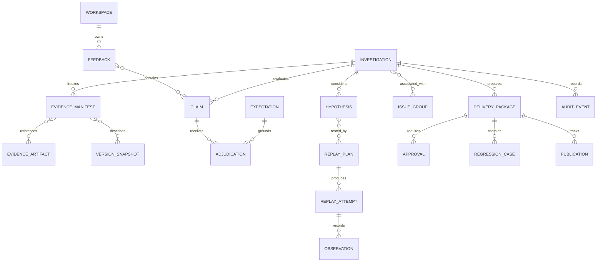

# Evaluape conceptual data model

Status: proposal only. Field descriptions are contracts to review, not migrations or executable schemas. Naming, storage layout, and database remain undecided. The same logical records should support an offline bundle and a later shared service. See [architecture](ARCHITECTURE.md) for deployment alternatives and [requirements](REQUIREMENTS.md) for acceptance conditions.

## 1. Design rules

1. Separate observed evidence, expectations, adjudications, hypotheses, experiments, and actions. They have different trust and revision semantics.
2. Every object has a schema version, stable local ID, trusted tenant/workspace scope, creation time, author/source, and revision/digest where applicable. External IDs are scoped by source system and tenant; they are not globally unique.
3. Evidence artifacts are append-only while retained. Corrections create new objects linked by `supersedes`; analysis and decisions also retain their revision history. A current-state projection may be mutable but must be reconstructable from valid revisions.
4. Missing, redacted, inaccessible, expired, not captured, corrupt, ambiguous, and not applicable are distinct states. `null` alone cannot carry all of these meanings. Unknown is not zero, false, or “no failure.”
5. Content identity is not authenticity. Source trust, acquisition method, integrity verification, and completeness have separate fields. A digest cannot prove that the producer told the truth.
6. Every relationship must stay within tenant scope unless a separately approved cross-tenant export/import creates a new, redacted lineage. No global duplicate index of private evidence is assumed.

## 2. Entity map

This is a conceptual relationship diagram, not a proposed ORM. A feedback record can contain several claims, and a claim may be investigated in a revised or related investigation without destroying the original linkage.

## 3. Core records

### Workspace and policy snapshot

Workspace: ID, tenant owner, allowed principals/roles, storage/residency policy reference, redaction policy, retention class, configured adapter identities, and default replay budget. Policy snapshots are immutable revisions used by approvals and runs. Do not store credentials in these records; store only references to separately governed secret storage if a future deployment needs it.

Offline V0 can have one explicit local workspace, but must not imply it has production multi-tenant isolation. A shared service requires enforced tenant keys and access tests on every storage path.

### Feedback

Fields: ID, source system and source record ID, source creation/receipt times, reporter identity or pseudonym where permitted, raw artifact reference, redacted text reference, run/trace/output references supplied by reporter, claimed severity, consent/data-use scope if applicable, and dedup ingestion key.

Feedback is untrusted content. Reporter severity is an input, not final priority. “This was wrong” should not silently become a precise expectation. The original wording is retained subject to privacy policy, while normalized claims are independently revisioned.

### Claim and expectation

Claim: ID, feedback references, target output/location, normalized proposition, applicable context/time, claim category, ambiguity notes, and expectation reference(s).

Expectation: ID/revision, normative source or reviewer decision, scope, effective time/version, predicate/rubric, allowed tolerances, applicability conditions, author, and review status. Sources might be a public specification, test contract, user-provided expected output, or explicit policy. A preference is labelled as such. Conflicting expectations remain visible; a model-generated expectation is only a proposal until reviewed.

### Investigation

Fields: ID, workspace, linked claims, lifecycle state, current revision, evidence manifest revision, assigned owner, reviewers, timestamps, priority assessment reference, open gaps, proposed next step, terminal reason, and related investigations.

Suggested operational states: `received`, `collecting`, `ready_for_adjudication`, `analyzing`, `awaiting_evidence`, `awaiting_approval`, `replaying`, `triaging`, `ready_for_delivery`, `delivering`, `closed`, `cancelled`, `blocked`. These are workflow states, never substitutes for verdict or causal status. Closed requires a reason such as `triage_complete`, `unsupported_reviewed`, `duplicate_linked`, `regression_verified`, or `cancelled_by_owner`; it does not default to “fixed.”

### Evidence artifact

Fields: ID, artifact kind, tenant-scoped storage reference, media type, byte size, digest algorithm/value, source system/object/version, source event time and acquisition time, acquisition actor/adapter version, integrity-check status, trust classification, sensitivity labels, retention/deletion state, permitted uses, completeness metadata, and optional parent/derivation links.

Artifact kinds include original input/output, trace span/event, tool request/result, retrieved document/chunk/ranking, expectation source, configuration, code/version manifest, model metadata, evaluator output, and replay result. Tool outputs and retrieved documents retain source identity and capture time, not merely excerpted prose.

An evidence citation uses artifact ID plus a stable locator, e.g. byte range, JSON pointer, span/event ID, or page/region. Redacted derivatives get their own digest and locator mapping. If redaction makes exact mapping impossible, say so. A missing artifact has a gap record, not a fabricated placeholder payload.

### Evidence manifest and gap

Manifest: ID/revision, sorted artifact references and digests, acquisition scope, required artifact checklist, achieved completeness, unresolved candidate joins, gap IDs, normalization/schema mapping versions, and manifest digest.

Gap: requested artifact/type, reason, attempts/timestamps, retryability, scope of affected claims, owner/next action, and whether reconstruction or redaction changes interpretation. “Complete” means complete against an explicit requested scope, not omniscient coverage.

### Version snapshot

Snapshot: ID/digest, observed run/deployment reference, observation time, component entries, reconstruction fidelity, unknowns, and related artifacts. Each component entry carries kind, observed identifier, immutable resolved digest/version if available, resolution evidence, resolver version, and availability status.

Track code, prompt/template, runtime/dependencies, configuration/feature flags, policy, model provider/name/revision, model parameters, tool definitions/implementation versions, retrieval corpus/index, embedding/reranker, evaluator/check version, environment resources, random seeds, time controls, and relevant cache state. Store only authorized configurations; secret values must be excluded. A mutable model alias or present-day corpus cannot be mislabelled an immutable historical snapshot.

### Adjudication

Fields: ID/revision, claim and expectation revisions, evidence manifest digest, deterministic check results, verdict (`substantiated`, `unsupported`, `unresolved`), rationale, supporting/contradicting citations, unresolved gaps, evaluator provenance, reviewer decision, and superseded adjudication link.

`substantiated`: the available evidence supports the scoped failure claim against the stated expectation. `unsupported`: sufficient relevant evidence contradicts that scoped claim. `unresolved`: evidence or specification is inadequate or conflicting. Failed collection alone can never produce `unsupported`.

Checks have `pass`, `fail`, or `indeterminate`, distinct from the claim verdict. Optional model suggestions record model/prompt/rubric version, supplied evidence subset, response artifact, cost and limitations. Numerical confidence is optional, not treated as calibrated without an evaluation study. A human can disagree without editing or erasing the original result.

### Hypothesis and evidence relationship

Hypothesis: ID/revision, explanation, mechanism, affected components, expected observations if true, competing explanations, proposed disconfirming test, evidence links, status, author, and scope limitations.

Evidence relationship: hypothesis ID, artifact/observation ID, relation (`supports_consistency`, `contradicts`, `irrelevant`, `intervention_support`), rationale and reviewer. These are claims about evidence, not properties of the evidence itself.

Suggested hypothesis statuses: `proposed`, `consistent_with_observations`, `disfavored`, `intervention_supported_in_replay`, `unresolved`. No `identified_root_cause` status is available merely from trace reading or a model explanation. A narrative using equivalent strong language must meet the intervention gate and still state its limited scope.

### Replay plan and budget

Plan: ID/revision/digest, hypothesis IDs, evidence/snapshot digests, baseline definition, intervention arms, variables held fixed, variables changed, outcome metrics/expected effects, fixtures/stubs, proposed sample sizes, randomization/pairing strategy where appropriate, nondeterminism controls, confounders, fidelity gaps, stopping rules, capability request, budget, policy revision, and required approvals.

Budget: maximum attempts, wall/CPU time, memory/process limits, output bytes, provider tokens/cost with currency, external requests, expiry, reserved amount and actual consumption. Concurrent reservations cannot exceed the approved cap. A revised experiment invalidates approvals that no longer match its digest/capabilities/budget.

Plan modes: deterministic recorded-fixture playback; isolated execution with recorded tool responses; controlled local intervention; explicitly approved external/provider call. “Replay” is not synonymous with actual execution of original external side effects.

### Replay attempt and observation

Attempt: ID, plan/arm, sequence, job lease generation, environment/image digest, actual component versions, seed/time settings, start/end times, status, resource usage, exit/error/cancellation reason, output artifact IDs, isolation/capability record, and differences from plan.

Observation: metric/check ID and version, value/unit or categorical result, sample reference, uncertainty summary when meaningful, comparison method, all included/excluded attempt IDs and exclusion reasons, analysis artifact, and limitations. Infrastructure failure is not an application failure and not silently removed from the record.

Attempts are append-only. Repeat baselines and interventions as the approved design specifies; preserve failed and nonreproducing runs. A changed environment becomes a new arm or explicit mismatch, never an invisible retry.

### Issue group, priority and ownership

Issue group: ID, tenant, canonical investigation, members, candidate/confirmed membership state, grouping method/version, symptom signature, cause evidence where available, merge/split decisions and reviewer. Approximate similarity only suggests membership. Retain distinct claims and evidence after a merge; allow reversal.

Priority assessment: severity, affected scope, observed frequency with denominator/time window or `unknown`, reproducibility, potential harm, urgency, evidence quality, estimated effort if known, proposed score/band, rationale, and reviewer override. Avoid false precision; never conflate feedback volume with prevalence.

Ownership: team/person reference, mapping source, confidence/status (`suggested`, `accepted`, `unassigned`), assignment history, and escalation rule. A suspected component owner is a routing suggestion, not blame.

### Delivery package and regression case

Package: ID/revision/digest, target/destination, issue title/body artifact, symptom/expectation, adjudication, evidence citations, competing hypotheses, experiment results and limitations, priority, owner, proposed next action, regression case IDs, disclosure/redaction review and publication scope.

Regression case: ID/version, origin investigation/claim, authorized redacted input fixtures, required snapshot/environment, expected behavior/assertions and rubric version, tool stubs, resource limits, stochastic evaluation design if needed, known limitations, owner, privacy review, and acceptance status. A case must assert the intended property rather than merely reproduce the old output. Cases that cannot safely include historical data use explicitly labelled synthetic replacements and describe lost fidelity.

### Approval and publication

Approval: ID, action kind, package/plan digest and revision, exact destination/audience, data scope, capability set, budget, policy version, requesting actor, deciding authenticated actor, decision (`approved`, `denied`, `revoked`), decision time, expiry, conditions, and consumption record. External content and model output cannot create approvals.

Publication: ID, package digest, approval ID, target adapter/version, idempotency key, request time, state (`pending`, `confirmed`, `failed`, `uncertain`), external ID/URL, confirmation time, reconciliation attempts, and error class. A timeout after submission is `uncertain`, not permission to send again. Reconcile the destination before retrying. Any change to consequential content or destination requires a matching new approval.

### Audit event and job

Audit event: ID, tenant, actor/service identity, timestamp, object/revision, action, prior/new state digest, authorization/policy reference, correlation/job ID, result, and non-sensitive reason. Do not log raw payloads or credentials. Tamper-evident chaining may detect alteration but does not remove the need for access control and retention.

Job: ID, tenant, investigation revision, command type, input digest, idempotency key, state, lease owner/expiry/generation, attempt count/cap, budget reservation, cancellation state and next eligible time. A stale lease must be unable to commit results to a newer revision. Retry is bounded and classified by transient/permanent/uncertain error.

## 4. Invariants and transition guards

- Evidence acquisition and manifest publication are two steps: verify all available artifact digests before marking the manifest ready. Missing artifacts stay explicit.
- A new evidence manifest does not silently overwrite an old adjudication; reevaluation creates a linked revision.
- An adjudication cannot omit the expectation or cite an artifact outside its manifest/scope.
- A hypothesis cannot become intervention-supported without at least one valid baseline/intervention comparison and disclosed limitations. The gate checks evidence structure, not automatic philosophical proof.
- Replay cannot start without an applicable policy, feasible sandbox, available budget reservation and required approval.
- Publication cannot start without an unexpired approval matching package digest, destination, audience and action. Worker identity alone is insufficient.
- Duplicate ingestion uses source+tenant+event ID; duplicate publication uses package+destination+approval operation identity. These are different dedup problems.
- Tenant scope must be checked on every foreign reference; a known opaque ID is not authorization.
- Deletion propagates to derivatives, caches, indexes, exports under local control and backup expiry workflows. Previously published copies may require separate destination remediation; deletion cannot promise removal outside the system's control.
- An evidence deletion/tombstone invalidates claims of fully reproducible evidence availability and marks affected regression cases unavailable or needing replacement.

## 5. Portability and migration

An offline investigation bundle should contain a versioned manifest, referenced authorized/redacted artifacts, snapshot, claims/expectations, analysis revisions, replay plans/results, review decisions and export drafts. No credentials, absolute private host paths, live production URLs with secrets, or executable embedded instructions are required. Import validates sizes, paths, hashes, schema versions and tenant ownership, and treats approvals as historical facts rather than transferable authority to publish.

Migrations are explicit and reversible where feasible: retain source schema/version, conversion tool/version, migration report and unknown fields. Re-normalizing telemetry creates new derived artifacts. Do not change historical evidence bytes to make an old record appear compatible with a new convention. Round-trip export/import tests should verify lineage, missing-data states and review history, not just field parsing.
